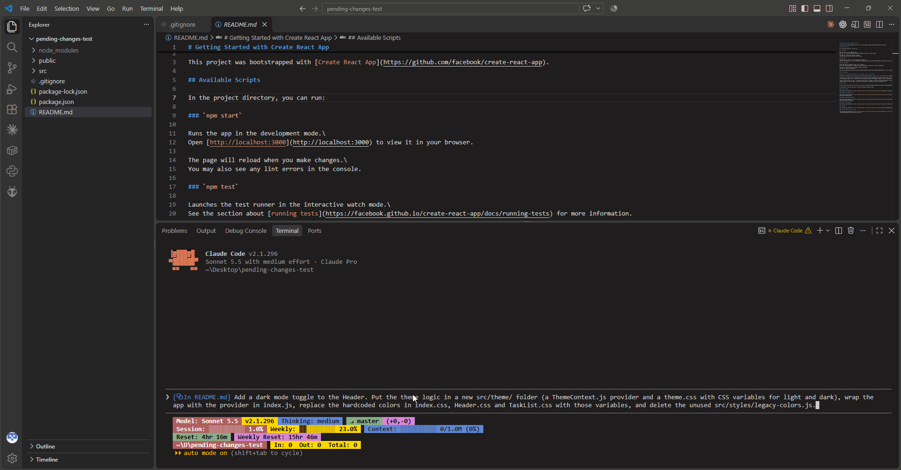

<div align="center">

# pending-changes

**Review every file Claude touches, like a pull request, without leaving the terminal.**

[](CHANGELOG.md)
[](LICENSE)
[](https://github.com/comertial/comertial-mods)



</div>

Claude just edited five files. Which ones? What changed? How do you undo only the bad part?

**pending-changes** docks a GitHub Copilot-style review pane next to your chat. Every file Claude creates, edits or deletes shows up as a tree with green/red line counts. Accept or reject per file, per folder or all at once, or open a side-by-side VS Code diff to revert single blocks. Whatever you decide, **Claude is told**, so its picture of the code never drifts from what's actually on disk.

```
/plugin install pending-changes --marketplace comertial/comertial-mods
```

## ✨ Highlights

| | |
| --- | --- |
| 🌳 **Changes as a tree** | Every changed file with `+added -removed` counts, a coloured `added` / `modified` / `deleted` status on every file, and collapsible, compact folders. |
| ✅ **One-click accept / reject** | Per file, per folder or everything. Reject restores originals, deletes new files (and the empty folders Claude made for them) and brings deleted files back. |
| 🔍 **Real diffs in VS Code** | Click a file for a side-by-side diff. Revert single blocks or edit by hand; the pane updates within ~2 seconds. |
| 🐚 **Catches shell changes too** | Not just Edit/Write: formatters, codegen, `git checkout`, `npm install`, scripts. Anything that moves in `git status` is tracked. |
| 🧠 **Claude stays in sync** | Every reject, revert or hand edit is reported back to Claude, so it never works from a stale picture of your code. |
| 💾 **Survives sessions** | In a git repo, the review list and its originals outlive `/clear`, `/exit` and new sessions, and sessions working in one checkout share one list. Pick the review up where you left it. |

```
▾ demo/config/                        +4 -0  [ ✓ ] [ ✗ ]
└─ settings.json  added               +4 -0  [ ✓ ] [ ✗ ]
▾ testFolder/                        +11 -1  [ ✓ ] [ ✗ ]
├─ ▾ sub/                             +7 -0  [ ✓ ] [ ✗ ]
│  ├─ deeper.json  added              +4 -0  [ ✓ ] [ ✗ ]
│  └─ notes.md  added                 +3 -0  [ ✓ ] [ ✗ ]
└─ test.txt  modified                 +1 -1  [ ✓ ] [ ✗ ]
t̶e̶s̶t̶.̶j̶s̶o̶n̶  deleted                     +0 -3  [ ✓ ] [ ✗ ]

5 files  +15 -4                 [ Accept all ]  [ Reject all ]
```

---

## Contents

- [🚀 Installation](#-installation)
- [🎮 Using it](#-using-it)
- [📡 What gets tracked](#-what-gets-tracked)
- [🧠 Keeping Claude in sync](#-keeping-claude-in-sync)
- [🚧 Limitations](#-limitations)
- [🩺 Troubleshooting](#-troubleshooting)
- [🤝 Contributing](#-contributing): development, releasing, and the [full spec](docs/SPEC.md)

---

## 🚀 Installation

Published through the [`comertial-mods`](https://github.com/comertial/comertial-mods) marketplace. In a Claude Code session:

```
/plugin install pending-changes --marketplace comertial/comertial-mods
```

Or from a shell:

```bash
claude plugin marketplace add comertial/comertial-mods
claude plugin install pending-changes@comertial-mods --scope user
```

`--scope user` loads it in every session, in any project. Verify with `claude plugin list`: it should show `pending-changes@comertial-mods` with `Status: ✔ enabled`.

| | |
| --- | --- |
| **Update** | `claude plugin marketplace update comertial-mods`, then `claude plugin update pending-changes@comertial-mods` |
| **Auto-update** | Off by default for third-party marketplaces. To get new versions on their own, open `/plugin` → **Marketplaces** → `comertial-mods` → **Enable auto-update**. |
| **Remove** | `claude plugin uninstall pending-changes@comertial-mods` |

**Requirements**

- **VS Code's `code` command on PATH** for the diff view. Without it, clicking a file shows a toast.
- **git (strongly recommended, not required).** Run Claude inside a git repo to track everything its shell commands change. Without git, the mod still works: Edit, Write and NotebookEdit are fully tracked, but shell commands are caught only for files already listed and for plain deletes of named files (see [Limitations](#-limitations)).

---

## 🎮 Using it

### The pane

It opens on its own the first time Claude changes a file in the project, or any time with **`/changes`**.

| | Where it shows |
| --- | --- |
| **`/changes`** | At any width: docked beside the chat on a wide fullscreen terminal (110+ columns), otherwise below the chat, above the prompt. |
| **On its own** | Claude Code only seats a pane a mod opens unprompted from 144 columns (110 once you've opened it with `/changes`, until you close it by hand). On a narrower terminal it waits, and a toast tells you to run `/changes`. |

| Element | What it does |
| --- | --- |
| **File row** | File name, then its status: a green `added` (underlined name) for files Claude created, a yellow `modified` (italic name) for files Claude edited, or a red `deleted` (struck-through, dim name) for files Claude deleted. Then green `+added` and red `-removed` counts. |
| **File name (click)** | Opens the VS Code diff for that file. |
| **✓ on a file** | Accepts: removes it from the list. The change is already on disk, so nothing else happens. |
| **✗ on a file** | Rejects: restores the original, deletes a file Claude created (plus any now-empty folders Claude created), or recreates a file Claude deleted. Then Claude is told. |
| **Folder row** | Bold colored name with ▾ (expanded) or ▸ (collapsed), plus the combined counts of everything under it. |
| **Folder name (click)** | Collapses or expands it. The state survives mod reloads. |
| **✓ / ✗ on a folder** | Accepts or rejects every file under it, including subfolders. |
| **Accept all / Reject all** | The same for every file in the list. |
| **Hover** | The row under the mouse gets a grey background, so it's clear which ✓/✗ belongs to which file. |
| **`other session` / `earlier`** | A dim tag on a file another session's Claude changed: one that's still running, or one that has ended. |
| **`other branch`** | A dim tag on a file changed while another branch was checked out. |
| **`other window`** | The same session is open in another window: this pane isn't shared, and a file with this tag may be out of date. A banner at the top says so. |
| **"N more pending outside this folder"** | Pending files elsewhere in the repo, outside the folder this session runs in. Open a session there to review them. |

**Layout:** folders come before files, each sorted by name. A folder containing only one other folder is merged into one row (`▾ demo/config/`), like VS Code's compact folders. Dim `├─` `└─` `│` guides show nesting below the top level. Long names are trimmed from the left with `…`.

### The diff view

Clicking a file runs `code --diff <original> <file>`:

- **Left (read-only):** a temp copy of the file before Claude touched it (empty for a new file).
- **Right (editable):** your real project file (an empty stand-in for a deleted file).

Revert single blocks with the gutter arrow between the sides (VS Code calls it "Revert Block"; it copies the original block back over Claude's version), edit the right side by hand, and save. Saves go straight to your project file. Within about 2 seconds:

- the pane's line counts update;
- if you reverted **every** block of an existing file, it matches its original, drops off the list, and Claude is told you reverted it;
- if you reverted **every** block of a **new** file (leaving it empty), it counts as a reject: the file and any now-empty folders Claude created for it are deleted, and Claude is told.

### Across sessions

In a git repo, the list is kept per checkout (each git worktree has its own):

- **A new session, `/clear` or `--resume`** picks up every file still pending, with its original, so ✓, ✗ and the diff work as before. Claude is told which files have unreviewed changes from an earlier session.
- **Two sessions in one checkout** share one list, in step within about 2 seconds. Each file belongs to the Claude that last changed it, and your decisions on it are reported to that Claude, wherever it runs.
- **The same session open in two windows:** the second one stops sharing, and says so with a banner in its pane and an `other window` tag on the files it listed then, or with a toast if the pane isn't open. It shares again once the first window closes.

The originals are stored in git's object store and pinned by a hidden ref, `refs/pending-changes/*`. Nothing is committed, nothing shows in `git status` or `git log`, and ordinary pushes and clones don't carry it.

### Settings

In `/config`:

| Setting | Default | What it does |
| --- | --- | --- |
| **Keep pending changes across sessions** (`persistAcrossSessions`) | on | Off: each session has its own list, and a new one starts empty. |
| **Open the pane at session start** (`openOnStart`) | `auto` | `auto` opens the pane when files are pending at start; `toast` only says so. |

---

## 📡 What gets tracked

Only files **inside the session's working directory**. Scratch scripts in temp folders and files elsewhere are ignored.

| Source of the change | How it's caught |
| --- | --- |
| Claude's **Edit**, **Write**, **NotebookEdit** | Directly: each call is hooked, the file's original is saved before the first touch, and the diff is recomputed after. |
| Claude's **Bash** / **PowerShell**, in a git work tree | `git status` before and after each command that might write. Edits, new files, deletions, renames (shown as delete + new), `git checkout`/`restore`, formatters, codegen, `npm install`, scripts. How the command is written doesn't matter. |
| Claude's shell commands, **outside** git | Only files already in the list, plus plain deletes of named files: `rm`, `del`, `erase`, `Remove-Item`, `ri`. |
| **Your own edits** to a listed file | The 2-second refresh updates the counts, and Claude is told on your next message. |

Not tracked: gitignored files (`node_modules`, build output, `.env`), files outside the project, and your edits to files that aren't listed.

**Multi-round changes.** The original is saved the **first** time Claude touches a file; later edits, in the same turn or later ones, add to the same diff. The pane always shows the **net** change from that first original, so a file Claude changes and then changes back disappears. Files stay listed across prompts, and in a git repo across sessions, until you resolve them. Each session still lists only the files under the folder it runs in.

---

## 🧠 Keeping Claude in sync

Notes are delivered to Claude as hidden context (Claude reads them; your chat doesn't show them), at whichever comes first: **the next tool result** if Claude is mid-task, or **your next message**.

| Event | Note Claude receives |
| --- | --- |
| You reject a change | "The user rejected your changes to `X`: it is back to its content from before you edited it. Re-read it before editing it again." |
| You reject a new file | "The user rejected your new file `X`: it has been deleted." |
| You reject a deletion | "The user rejected your deletion of `X`: it has been restored." |
| You revert every block in the diff | "The user reverted all your changes to `X`…" (or the new-file rejection above) |
| You edit a listed file yourself | "The user modified `X` after your last edit; re-read it before editing it again." |
| You delete a listed file yourself | "The user deleted `X` after your last edit." |
| You accept | Nothing. |

With several sessions, a note goes to the Claude that made the change, in whichever session it runs. That Claude is also told when another session's Claude edits one of its files ("`X` was since edited by another Claude session"). If the session that made a change has ended, a Claude that was told about the file in a later session hears of your edits and reverts to it.

Each of your edits is reported once. As a backstop, Claude Code's Edit tool already refuses to edit a file that changed since Claude last read it.

---

## 🚧 Limitations

- **Gitignored files** and files outside the project are never tracked, by design.
- **Non-git folders:** shell commands are tracked only for files already in the list and for plain `rm`/`del`/`Remove-Item` of named files. Edits and new files made by shell commands are missed, as are deletes using globs or variables, inside scripts, or of whole folders. Run inside a git repo for full tracking.
- **Committed inside one command:** a clean file that is changed **and committed** within a single command never shows in `git status`, so it's invisible.
- **Dirty-file snapshot cap:** at most 500 already-changed files are saved before a shell command. In a repo with more uncommitted changes than that, the rest have no "before" content.
- **Concurrent edits:** if you save a file in VS Code while one of Claude's shell commands is running, the change is attributed to Claude. It still shows up for review.
- **The 2-second refresh** reads every listed file each tick. Fine for normal use; hundreds of large files would make it heavier.
- **Collapsed folders are remembered by path:** a folder that disappears and later comes back reappears collapsed.
- **Only in git:** outside a git repo, or with *Keep pending changes across sessions* off, a new session starts with an empty list, and pending changes from a previous session are just files on disk.
- **Copying the whole repo** with `git push --mirror`, a `refs/*:refs/*` refspec, `git clone --mirror` or `git bundle create --all` copies the hidden ref, and your originals with it. `git fast-export --all` (and `git filter-repo`) warns about it. Ordinary push, `--all`, `--tags` and clone don't. See [Troubleshooting](#-troubleshooting) to remove it.
- **Very large files:** an original over about 4 MiB is kept in its session only. Files from other sessions too large to fit the session's list are left out of its pane, with a toast.
- **Branch switches:** pending changes outlive them. Rows from another branch are tagged, but ✗ still restores the original they were recorded against.
- **Crashes:** a crashed session counts as ended only after 30 seconds.
- **Two sessions running shell commands at once:** a file the other session's Claude changes during this session's command can be attributed to this session's Claude. It is still listed for review.
- **Non-UTF-8 files:** ✗ rewrites them as UTF-8 ([#3](https://github.com/comertial/claude-pending-changes/issues/3)).

---

## 🩺 Troubleshooting

| Symptom | Likely cause / fix |
| --- | --- |
| The pane doesn't appear | The terminal is too narrow for Claude Code to open it unprompted (see [The pane](#the-pane)); a toast says so. Run `/changes`, which opens it at any width. |
| Clicking a file does nothing / toast "Could not open VS Code" | `code` isn't on PATH. In VS Code: *Command Palette → Shell Command: Install 'code' command in PATH*. |
| Counts don't update after saving in VS Code | The refresh timer isn't running. Any tool call, prompt or `/changes` restarts it. If it persists, check `claude --debug` for `pending-changes` lines. |
| A shell change wasn't listed | The file is gitignored, outside the project, or the folder isn't a git repo (only plain deletes are caught there). Or the command matched the read-only list. |
| The hook seems to run twice | The installed copy and a `--plugin-dir` / session dev copy are both loaded. Use one. |
| A diff tab shows "deleted" | Its temp file was cleaned up after accept/reject. Close the tab. |
| `test.json` shows `+3 -2` after a PowerShell edit | Windows PowerShell 5.1's `-Encoding utf8` adds a byte-order mark to the first line. That's the command, not the mod. |
| The pane (or a toast) says the session is open in another window | The same session id runs in two Claude Code windows (a `--resume` of a running session). The later one stops sharing its list, and rows tagged `other window` may be out of date; it shares again once the other window closes. |
| A row shows `other branch` | It was changed while another branch was checked out. Review it before ✗: it restores the original from that branch. |
| You uninstalled the mod and want its data gone | In each repo: `git for-each-ref --format="delete %(refname)" refs/pending-changes/ \| git update-ref --stdin`, then delete the `pending-changes` folders in `.git/` and `.git/worktrees/*/`. git's own gc then reclaims the originals. |

---

## 🤝 Contributing

See the [roadmap](ROADMAP.md) for what's planned and where help is wanted. The full reference for how the mod behaves and why, including its internals, design decisions and test coverage, is [`docs/SPEC.md`](docs/SPEC.md). Features, bug fixes and research start with a short spec in [`docs/specs/`](docs/specs/README.md), and `docs/SPEC.md` is updated when they ship.

<details>
<summary><b>Development</b>: run from a local clone</summary>

Clone the repository and load the clone directly. If you installed the mod from the marketplace, uninstall it first.

For a single session:

```bash
git clone https://github.com/comertial/claude-pending-changes.git
claude --plugin-dir ./claude-pending-changes
```

To load it in every session, put the clone's absolute path in `CLAUDE_CODE_PLUGIN_DIRS` in the `env` block of `~/.claude/settings.json`. Separate several folders with `;` on Windows and `:` elsewhere:

```json
{ "env": { "CLAUDE_CODE_PLUGIN_DIRS": "/path/to/claude-pending-changes" } }
```

Saves then reload the module on their own, after the current turn ends. Don't run both the installed copy and a `--plugin-dir` copy in one session, or the hooks run twice.

Checks:

```bash
# manifest + module: what it hooks and calls, and anything the engine would refuse
claude plugin validate ./claude-pending-changes

# the test suite
claude plugin test ./claude-pending-changes
```

**Type-checking:** once the engine has loaded the mod from a folder it watches, it writes `.claude-plugin/types/` and a `tsconfig.json`, so `tsc -p <folder>` works. Otherwise use a `tsconfig.json` kept **outside** the mod folder. Its `include` names the engine's `claude-code.d.ts` (written by the plugin-authoring skill) plus this folder's `hooks` and `types`, with `"jsx": "react", "jsxFactory": "h"`.

**Debugging:** run `claude --debug`. A hook that throws is skipped and logged. A pane tree that doesn't validate is logged as `ui.render (Pane): a hook returned a tree that does not validate`, with the reason.

</details>

<details>
<summary><b>Releasing</b></summary>

1. Bump `version` in `.claude-plugin/plugin.json` (semver).
2. Move the `[Unreleased]` notes in `CHANGELOG.md` under the new version.
3. Commit, tag `vX.Y.Z`, push the tag and create a GitHub release.

Installed users pick up the new version with `claude plugin marketplace update comertial-mods`, then `claude plugin update pending-changes@comertial-mods`. If the marketplace entry in `comertial/comertial-mods` pins a `ref`, bump it there as well.

</details>

---

## 📄 License

[GPL-3.0](LICENSE). This is an independent project, not affiliated with or endorsed by Anthropic. Claude and Claude Code are products of Anthropic.
